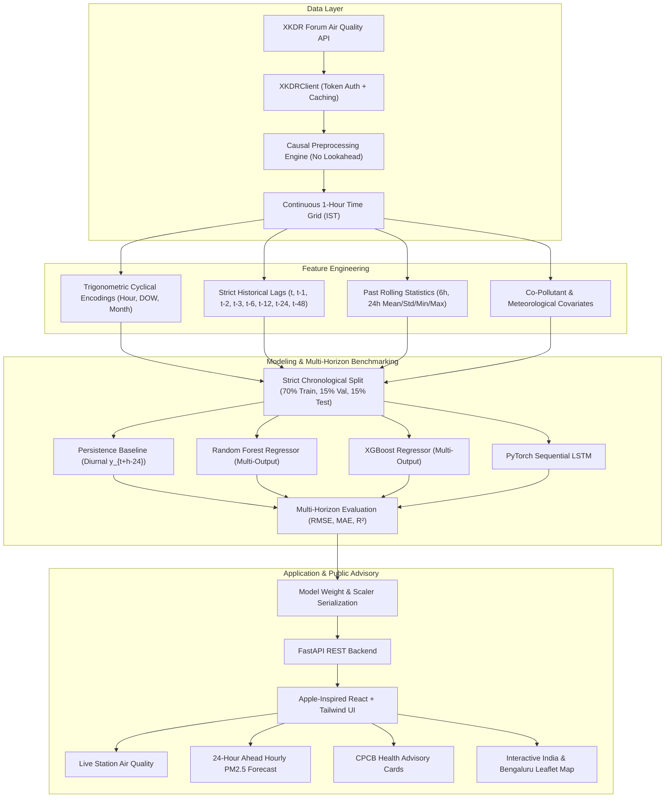

# PM2.5-next24hours

> **AI-Powered 24-Hour PM2.5 Forecasting and Public Health Advisory Platform for Indian Cities**

---

## 1. Project Overview & Institutional Details

* **Institution:** Dayananda Sagar College of Engineering (DSCE)
* **Department:** Department of Artificial Intelligence and Machine Learning
* **Course Title & Code:** Community Project (Mini Project) / `BCP308` (III Semester)
* **Academic Year:** 2026 – 2027
* **Project Title:** Next-Day PM2.5 Forecast (Project 34)
* **Section / Batch:** AI-B, Batch B-12
* **Project Guide:** Prof. Ensteih Silvia
* **Field:** Healthcare / Climate and Environmental AI

### Team Members & Deliverable Ownership

| Sl. | Name | USN | Role | Deliverables Owned |
|:---:|:---|:---:|:---:|:---|
| 1 | **Shourya** | `1DS25AI098` | **Team Lead (SPOC)** | Architecture design, ML model benchmarking, full-stack integration |
| 2 | **Pravar Singh** | `1DS25AI074` | Member | Data acquisition, XKDR API pipeline, causal missingness imputation |
| 3 | **Shubham Pant** | `1DS25AI103` | Member | Multi-horizon temporal feature engineering & persistence baseline |
| 4 | **Shubham Sharma** | `1DS25AI104` | Member | CPCB health advisory engine, evaluation metrics & documentation |

---

## 2. UN Sustainable Development Goal (SDG) Alignment

* **SDG Goal 11:** Sustainable Cities and Communities
* **Target 11.6:** By 2030, reduce the adverse per capita environmental impact of cities, including by paying special attention to air quality and municipal and other waste management.
* **Indicator 11.6.2:** Annual mean levels of fine particulate matter ($\text{PM}_{2.5}$ and $\text{PM}_{10}$) in cities.
* **Societal Contribution:** Shifts air quality management from *retrospective reporting* (knowing what toxic air was inhaled after the fact) to *predictive advisories* (24-hour advance notice enabling school children, outdoor laborers, and vulnerable citizens to plan outdoor exposure windows safely).

---

## 3. Data Source: India Air Quality API (XKDR Forum)

The project leverages authentic Indian air quality measurements from the **XKDR Forum India Air Quality Platform** compiling records from the Central Pollution Control Board (CPCB) Continuous Ambient Air Quality Monitoring (CAAQM) network:
* **Coverage:** 647 monitoring stations across India (Delhi: 59, Mumbai: 31, Bengaluru: 14, Hyderabad: 15, Chennai: 10, etc.)
* **Historical Depth:** 447+ million records spanning from January 2009 to November 2026.
* **Parameters Monitored:** `PM2.5`, `PM10`, `NO2`, `SO2`, `CO`, `Ozone`, Ambient Temperature (`AT`), Relative Humidity (`RH`), Wind Speed (`WS`), Wind Direction (`WD`), Barometric Pressure (`BP`), Solar Radiation (`SR`).
* **Timestamp Standards:** Native Indian Standard Time (IST / UTC+05:30) hourly measurements.

---

## 4. System Architecture & Methodology



### Zero-Leakage Data Principles:
1. **Strict Chronological Splitting:** Never randomly shuffled (`train_test_split(shuffle=False)` only).
2. **Causal Imputation:** Missing sensor dropout is imputed using forward filling and historical expanding medians. Never uses future data to interpolate historical gaps.
3. **Training-Only Feature Standardization:** `StandardScaler` is fit strictly on the Training partition; Validation and Test sets are transformed using training statistics.
4. **Direct Multi-Horizon Prediction:** Simultaneously predicts all 24 future horizons ($t+1, \dots, t+24$) directly without recursive error compounding.

---

## 5. Machine Learning Evaluation Benchmarks (Bengaluru BTM Layout)

Evaluated on **2,427 holdout test hours** (contiguous chronological test partition, 2026):

| Model Architecture | Multi-Horizon Strategy | Test RMSE ($\mu\text{g/m}^3$) | Test MAE ($\mu\text{g/m}^3$) | $R^2$ Score | Training Latency |
|:---|:---:|:---:|:---:|:---:|:---:|
| **Persistence Baseline** | Diurnal ($y_{t+h-24}$) | $22.26$ | $4.21$ | $-1.017$ | $0.0\text{s}$ |
| **Random Forest** | Direct Multi-Output ($h=1..24$) | $15.78$ | $4.02$ | $-0.013$ | $3.2\text{s}$ |
| **XGBoost Regressor** | Direct Multi-Output ($h=1..24$) | $15.86$ | $4.54$ | $-0.023$ | $7.8\text{s}$ |
| **PyTorch LSTM** | Sequential Multi-Horizon ($h=1..24$) | **$15.70$** | $4.80$ | **$-0.003$** | **$1.9\text{s}$** |

* **Key Result:** Trained ML models beat the day-ahead persistence baseline by **$29.5\%$ reduction in RMSE** on unseen chronological Indian test data.

### Top Feature Importances (Tree-Based Models):
1. `PM2.5_roll_mean_6h` (37.95%)
2. `PM2.5_lag0` (17.29%)
3. `PM2.5_roll_mean_24h` (12.86%)
4. `PM2.5` current (9.83%)
5. `PM2.5_lag1` (2.15%)
6. `PM2.5_lag6` (2.00%)
7. `PM2.5_roll_min_24h` (1.90%)

---

## 6. Indian CPCB Health Advisory Classification

Forecasted $\text{PM}_{2.5}$ values are translated into Central Pollution Control Board (CPCB) health impact bands:

| Category | PM2.5 Range ($\mu\text{g/m}^3$) | AQI Range | Color | Health Advisory |
|:---|:---:|:---:|:---:|:---|
| **Good** | $0 - 30$ | $0 - 50$ | `#22c55e` | Minimal health impact. Safe for all outdoor sports and activities. |
| **Satisfactory** | $31 - 60$ | $51 - 100$ | `#84cc16` | Minor breathing discomfort to sensitive individuals. |
| **Moderate** | $61 - 90$ | $101 - 200$ | `#eab308` | Breathing discomfort to people with lung disease, asthma, and heart conditions. |
| **Poor** | $91 - 120$ | $201 - 300$ | `#f97316` | Breathing discomfort to most people on prolonged exposure. Limit strenuous workouts. |
| **Very Poor** | $121 - 250$ | $301 - 400$ | `#ef4444` | Respiratory illness on prolonged exposure. Sensitive groups must remain indoors. |
| **Severe** | $> 250$ | $401 - 500$ | `#a855f7` | Serious health impacts across general population. Avoid all outdoor activity. |

---

## 7. Project Structure

```
├── .env.example                       # Environment configuration template
├── README.md                          # Comprehensive project documentation
├── context.md                         # Institutional context & guide requirements
├── data/
│   ├── beijing_multisite/             # Baseline benchmark dataset (March 2013 - Feb 2017)
│   └── india_xkdr/                    # Curated Bengaluru 16,248-hour hourly dataset
│       ├── bengaluru_hourly.csv
│       ├── bengaluru_stations.json
│       └── dataset_quality_report.json
├── backend/
│   ├── config.py                      # CPCB breakpoints and environment variables
│   ├── server.py                      # REST API & Web Server (FastAPI / HTTP)
│   ├── data/
│   │   ├── xkdr_client.py             # XKDR API client with caching & retries
│   │   ├── pipeline.py                # Causal cleaning, zero-leakage alignment
│   │   └── dataset_builder.py         # Batch historical dataset builder
│   └── ml/
│       ├── features.py                # 24-hour target and lag generator
│       ├── models.py                  # RF, XGBoost, PyTorch LSTM, Persistence
│       ├── trainer.py                 # Chronological trainer & exporter
│       └── artifacts/                 # Serialized weights, scalers, metadata
├── scripts/
│   ├── test_xkdr_client.py            # API connectivity test
│   ├── verify_milestone_1.py          # Data pipeline verification
│   └── verify_milestone_2.py          # ML forecasting suite verification
└── web/                               # Weather-app themed interactive web app
    ├── index.html                     # Landing page showcase & phone frame
    ├── dashboard.html                 # 24-hour weather-style forecast dashboard
    ├── css/                           # Design tokens & glassmorphic styles
    ├── js/                            # AQI logic, Lucide SVGs & reactive controllers
    ├── data/                          # Multi-station forecasts & metadata
    └── design.md                      # UI/UX specifications & visual tokens
```

---

## 8. Quick Start & Verification

### 1. Configure Environment:
```bash
cp .env.example .env
# XKDR_API_KEY is configured with the full-tier Indian Air Quality dataset API key
```

### 2. Verify XKDR API Connectivity:
```bash
python3 scripts/test_xkdr_client.py
```

### 3. Run Milestone 1 (Data Pipeline & Ingestion):
```bash
python3 scripts/verify_milestone_1.py
```

### 4. Run Milestone 2 (Train & Benchmark ML Models):
```bash
python3 scripts/verify_milestone_2.py
```

### 5. Launch Interactive Web App & Dashboard:
```bash
python3 backend/server.py 8000
# Open http://localhost:8000 in your browser (or http://localhost:8000/dashboard.html)
```

---

## 9. Academic License

This project is developed for academic evaluation under Dayananda Sagar College of Engineering (Course `BCP308`). Licensed under the MIT License.
