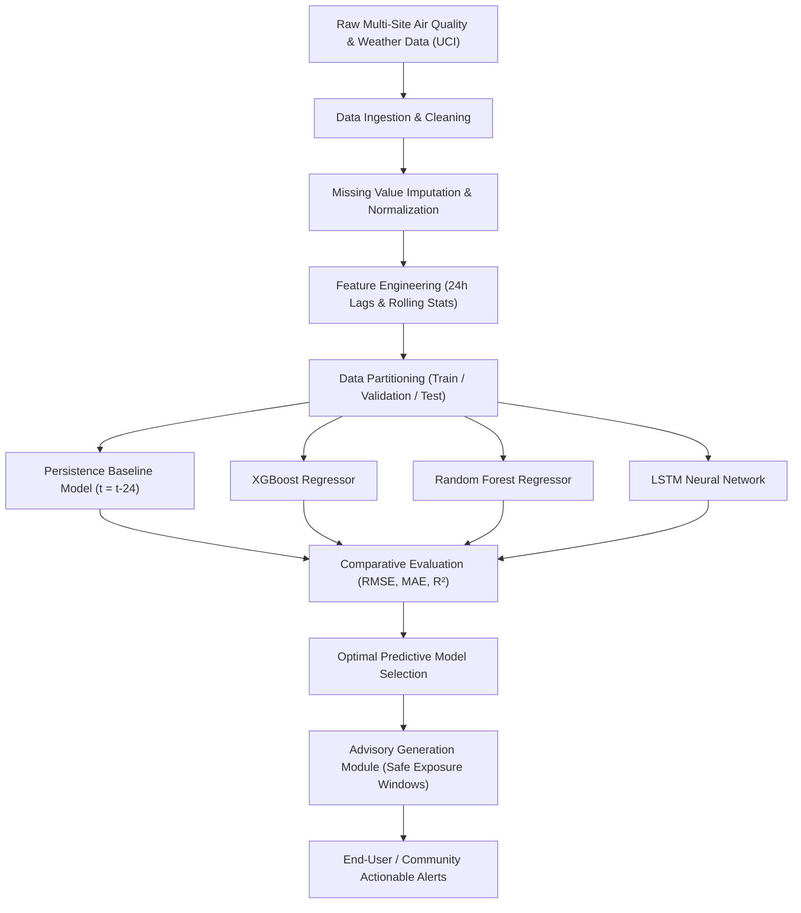

# Project Context: Next-Day PM2.5 Forecast

## 1. Project Overview & Institutional Metadata

- **Institution:** Dayananda Sagar College of Engineering
- **Department:** Artificial Intelligence and Machine Learning
- **Course Title & Code:** Community Project (Mini Project) / `BCP308` (III Semester)
- **Academic Year:** 2026 – 2027
- **Project Title:** Next-Day PM2.5 Forecast
- **Project Reference No.:** Project 34
- **Section / Batch:** AI-B, Batch B-12
- **Field of Project:** Healthcare / Climate and Environment
- **Project Guide:** Prof. Ensteih Silvia
- **Project Timeline:** October – December 2026

---

## 2. Team Members & Roles

| Sl. | Name | USN | Phone Number | Email ID | Role | Key Responsibilities & Deliverables Owned |
|:---:|:---|:---|:---|:---|:---|:---|
| 1 | **Shourya** | 1DS25AI098 | 7479910333 | toshouryaop@gmail.com | **Team Lead (SPOC)** | Overall coordination, architecture design, ML model training & tuning |
| 2 | **Pravar Singh** | 1DS25AI074 | 8969779482 | pravarsingh17@gmail.com | Member | Data acquisition, cleaning, preprocessing pipeline & missing value handling |
| 3 | **Shubham Pant** | 1DS25AI103 | 7217532961 | pantshubham16@gmail.com | Member | Feature engineering (lagged variables/rolling statistics) & persistence baseline |
| 4 | **Shubham Sharma** | 1DS25AI104 | 8910967315 | shubham.entertainment7@gmail.com | Member | Advisory generation module, performance metrics evaluation & documentation |

---

## 3. UN Sustainable Development Goals (SDG) Alignment

- **SDG Goal:** **SDG 11 — Sustainable Cities and Communities**
- **SDG Target:** **Target 11.6** — Reduce the adverse per capita environmental impact of cities, including by paying special attention to air quality and municipal and other waste management.
- **SDG Indicator:** **Indicator 11.6.2** — Annual mean levels of fine particulate matter (e.g., PM2.5 and PM10) in cities (population-weighted).
- **Local Scale Contribution:** Delivers a localized 24-hour predictive PM2.5 advisory framework that mitigates personal community exposure in urban wards.

---

## 4. Problem Formulation & Scope

### 4.1 Project Introduction & Background
Urban residents currently discover that atmospheric air was severely polluted only after inhaling it throughout the day, as existing monitoring infrastructure solely reports present or historical conditions. According to global WHO estimates, atmospheric fine particulate matter ($\text{PM}_{2.5}$) exposure accounts for over 4 million premature deaths annually, with urban centers suffering the greatest concentration of high-exposure days. The absence of predictive advisories leaves vulnerable populations—such as school children, elderly citizens, and daily outdoor workers—completely exposed to peak diurnal pollution spikes.

Conventional air quality reporting relies on static sensor stations operated by environmental agencies, which publish historical averages or hourly snapshots. While informative, real-time measurements fail to provide sufficient lead time for individuals to plan outdoor activity, wear protective equipment, or adjust travel schedules. Addressing this gap requires shifting from passive measurement to predictive forecasting, leveraging historical pollutant trends alongside continuous meteorological variables.

This project develops a 24-hour ahead $\text{PM}_{2.5}$ forecasting framework across monitoring sites by training machine learning architectures on multi-site lagged air pollutant readings and meteorological factors, benchmarked rigorously against a persistence baseline model. The resulting forecast generates actionable hourly advisories highlighting safer outdoor exposure windows.

### 4.2 Problem Statement
> Urban residents and outdoor workers lack advance warning regarding harmful particulate levels, leading to unmitigated exposure during peak pollution hours because current monitoring systems only report retrospective or real-time conditions rather than predictive, actionable advisories.

### 4.3 Technical & Practical Challenges
1. **Class Imbalance & Extreme Values:** Extreme spikes during severe pollution episodes create skewed target distributions.
2. **Missing Sensor Data:** Continuous multi-sensor meteorological and air pollutant values exhibit missing readings across stations.
3. **Temporal Dynamics:** High temporal autocorrelation and non-linear lag dependencies in atmospheric data.
4. **Micro-Meteorological Dynamics:** Localized weather variations and sudden vehicular emission peaks.
5. **Spatial Generalizability:** Transferability of models trained on specific monitoring sites across neighboring spatial grids.

### 4.4 Project Constraints
- **Hardware/Compute:** Development restricted to Google Colab free tier (GPU/RAM limits).
- **Dataset Scope:** Historical hourly multi-site records spanning March 2013 to February 2017.
- **Data Integrity:** Missing data imputation must avoid synthetic ground truth fabrication.
- **Timeline:** Strictly bounded by a 12-week academic semester schedule.

### 4.5 Complex Engineering Problem (WP) Attributes

| Code | Attribute | Justification |
|:---|:---|:---|
| **WP1** | Depth of knowledge required | Applies time-series modeling and deep learning concepts beyond standard regression. |
| **WP2** | Range of conflicting requirements | Balances forecast accuracy, latency, compute limitations, and public advisory clarity. |
| **WP3** | Depth of analysis required | Demands non-linear spatiotemporal feature modeling of multi-pollutant and weather inputs. |
| **WP4** | Familiarity of issues | Deals with highly non-stationary atmospheric shifts and localized pollution spikes. |
| **WP5** | Extent of applicable codes | Integrates UN SDG environmental metrics beyond routine software specifications. |
| **WP6** | Extent of stakeholder involvement | Caters to public citizens, school administrators, municipal bodies, and outdoor workers. |
| **WP7** | Interdependence | Coordinates data ingestion, feature engineering, ML forecasting, and advisory generation. |

---

## 5. Literature Review & Research Gap

### 5.1 Review of Related Work

| Sl. | Author(s) & Year | Title & Source | Method Used | Key Findings | Limitation Identified |
|:---:|:---|:---|:---|:---|:---|
| 1 | S. Zhang et al. (2017) | *Cautionary tales on air-quality improvement in Beijing*, Proc. Royal Soc. A | Statistical analysis & multi-site regression | Evaluated multi-site $\text{PM}_{2.5}$ trends and meteorological interactions across Beijing. | Lacks individual hourly advisory generation for public exposure prevention. |
| 2 | X. Li et al. (2020) | *Deep LSTM Networks for Urban Air Quality Index Prediction*, IEEE Access | Stacked LSTM Networks | Achieved strong 6-hour forecast accuracy using sequential features. | Performance drops significantly beyond a 12-hour forecast horizon. |
| 3 | Y. Wang & M. Zhang (2021) | *Air Pollution Concentration Forecasting Using XGBoost*, Env. Modelling | Gradient Boosted Trees (XGBoost) | Tree-based models outperformed linear models on tabular weather attributes. | Struggles to capture continuous temporal lag correlations without extensive feature engineering. |
| 4 | H. Liu et al. (2022) | *Spatiotemporal Graph Convolutional Networks for PM2.5 Prediction*, Atmos. Env. | ST-GCN Architecture | Captured inter-station spatial dependencies effectively. | High computational requirements; infeasible for lightweight/free-tier deployment. |
| 5 | J. Chen et al. (2023) | *Hybrid Random Forest-LSTM Framework for Particulate Forecasting*, Urban Climate | Hybrid RF-LSTM | Improved prediction stability across seasonal shifts. | Did not benchmark against simple persistence models to prove true gain. |
| 6 | CPCB Report (2024) | *National Air Quality Index Evaluation Report*, Ministry of Env. | Empirical AQI Analysis | Highlighted acute public health risks of retrospective AQI reporting. | Provides monitoring standards without predictive model integration. |

### 5.2 Research Gap Identified
Existing literature focuses primarily on generalized city-wide hourly regression or macro-level air quality indexing without delivering actionable 24-hour ahead advisories for specific local communities. Furthermore, published studies rarely evaluate predictive gains directly against a strict persistence baseline or structure output formats to prevent real-world exposure during peak diurnal pollution hours.

---

## 6. Project Objectives

1. **Collect and preprocess** multi-site meteorological and air pollutant datasets by resolving missing values and generating lagged time-series features.
2. **Build and evaluate** machine learning models (XGBoost, Random Forest, and LSTM) for 24-hour ahead $\text{PM}_{2.5}$ forecast accuracy.
3. **Compare model performance** against a persistence baseline using standard regression metrics ($\text{RMSE}$, $\text{MAE}$, $R^2$) and deploy an advisory generation module.

---

## 7. Proposed Methodology & System Architecture

### 7.1 Dataset Specifications
- **Dataset Name:** UCI Beijing Multi-Site Air Quality Data (Dataset ID: 501)
- **Source URL:** [UCI Machine Learning Repository](https://archive.ics.uci.edu/dataset/501/beijing+multi+site+air+quality+data)
- **Scale:** 420,768 records $\times$ 18 features (across 12 monitoring sites)
- **Target Variable:** Continuous regression target ($\text{PM}_{2.5}$ concentration in $\mu\text{g/m}^3$)
- **Licence:** Creative Commons Attribution 4.0 International (CC BY 4.0)
- **Known Limitations:** Historical data (2013–2017) based in Beijing; domain adaptation necessary for local deployment (e.g., Indian CPCB contexts).

### 7.2 Technical Stack
- **Programming Language:** Python 3.x
- **Data Manipulation & Analysis:** Pandas, NumPy
- **Machine Learning & Deep Learning:** Scikit-Learn, XGBoost, TensorFlow / Keras
- **Visualization:** Matplotlib, Seaborn
- **Environment:** Google Colab (Free Tier) / Local Jupyter Notebook

### 7.3 Workflow & Architecture Diagram



---

## 8. Performance Benchmarks & Expected Deliverables

### 8.1 Performance Targets vs Baseline

| Sl. | Metric to be Reported | Baseline (Persistence Model) | Target Value | Evaluation Method |
|:---:|:---|:---:|:---:|:---|
| 1 | **Root Mean Squared Error (RMSE)** | $\sim 35.0\ \mu\text{g/m}^3$ | **$< 20.0\ \mu\text{g/m}^3$** | Hold-out test set evaluation |
| 2 | **Mean Absolute Error (MAE)** | $\sim 25.0\ \mu\text{g/m}^3$ | **$< 14.0\ \mu\text{g/m}^3$** | Hold-out test set evaluation |
| 3 | **Coefficient of Determination ($R^2$)** | $0.45$ | **$> 0.75$** | Regression metrics calculation |

### 8.2 Deliverables
1. Cleaned datasets and reproducible preprocessing/engineering Jupyter notebooks.
2. Trained model weights (XGBoost, Random Forest, LSTM) with performance benchmark reports against the persistence baseline.
3. Working advisory generation script indicating safe/unsafe exposure windows across upcoming 24 hours.
4. Comprehensive mini-project synopsis and final project documentation report.

---

## 9. Budget Estimation

| Sl. | Item / Head of Expenditure | Quantity | Unit Cost (₹) | Total (₹) | Justification |
|:---:|:---|:---:|:---:|:---:|:---|
| 1 | Compute Resources (Colab) | 1 | 0 | 0 | Google Colab Free Tier Used |
| 2 | Internet / Data Access | 1 | 0 | 0 | Existing campus network connection |
| 3 | Report Printing & Binding | 1 | 0 | 0 | Digital submission |
| | **Total Estimated Cost** | | | **₹ 0** | **Nil — Free tier used** |

---

## 10. Project Schedule & Milestones

### 10.1 Work Breakdown Structure (WBS)

```
[Oct 01 - Oct 15: Proposal/Synopsis] ➔ [Oct 16 - Oct 31: Data Pipeline (Milestone 1)] ➔ [Nov 01 - Nov 30: Model Development (Milestone 2)] ➔ [Dec 01 - Dec 31: Evaluation & Report (Milestone 3)]
```

| Sl. | Phase / Task | Responsible Member(s) | Timeline | Deliverable / Milestone |
|:---:|:---|:---|:---:|:---|
| 1 | Literature Survey & Synopsis Preparation | All Members | Oct 01 – Oct 15 | Approved Synopsis |
| 2 | Dataset Acquisition & Preprocessing | Pravar Singh | Oct 16 – Oct 31 | Cleaned dataset pipeline (Milestone 1) |
| 3 | Feature Engineering & Baseline Setup | Shubham Pant | Nov 01 – Nov 15 | Persistence baseline metrics |
| 4 | ML Model Development & Hyperparameter Tuning | Shourya | Nov 16 – Nov 30 | Trained models (Milestone 2) |
| 5 | Advisory Module & Comprehensive Evaluation | Shubham Sharma | Dec 01 – Dec 15 | Working demonstration & evaluation report |
| 6 | Final Documentation & Presentation | All Members | Dec 16 – Dec 31 | Final Review Submission (Milestone 3) |

---

## 11. References (IEEE Format)

1. S. Chen, "Beijing Multi-Site Air Quality," UCI Machine Learning Repository, 2017. [Online]. Available: `https://doi.org/10.24432/C5RK5G`.
2. S. Zhang, B. Guo, A. Dong, J. He, Z. Xu, and S. Chen, "Cautionary tales on air-quality improvement in Beijing," *Proceedings of the Royal Society A*, vol. 473, no. 2205, p. 20170457, 2017.
3. X. Li, L. Peng, X. Yao, S. Wang, and Y. Zhang, "Long short-term memory neural network for air quality index prediction," *IEEE Access*, vol. 8, pp. 21403–21412, 2020.
4. Y. Wang and M. Zhang, "Air pollution concentration forecasting using gradient boosted decision trees," *Environmental Modelling & Software*, vol. 136, p. 104936, 2021.
5. H. Liu, G. Dong, and Y. Li, "Spatiotemporal graph convolutional networks for multi-station PM2.5 forecasting," *Atmospheric Environment*, vol. 268, p. 118810, 2022.
6. Central Pollution Control Board (CPCB), "National Air Quality Index Evaluation and Reporting Guidelines," Ministry of Environment, Forest and Climate Change, Govt. of India, Tech. Rep., 2024.
